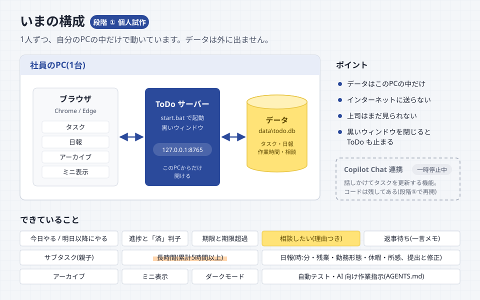
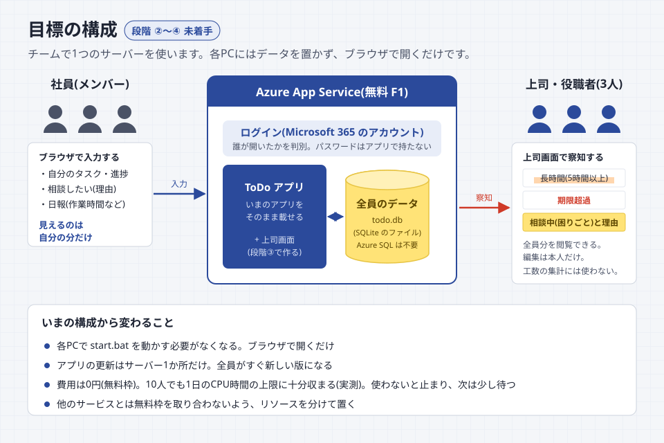
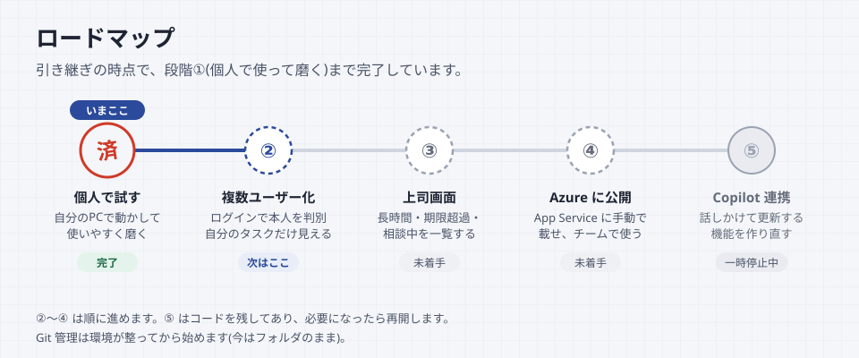

# ToDoリスト(個人用)

この端末だけで動く軽量ToDoアプリ。FastAPI + Jinja2 + htmx + SQLite。ビルド不要。

## 構成とロードマップ

### いまの構成(段階①)



今は各自のPCの中だけで動いています。データは `data	odo.db` という1つのファイルにあり、外部には送りません。上司はまだ見られません。

### 目標の構成(段階②〜④)



アプリとデータベースを丸ごと Azure App Service(無料プラン)に置き、全員がブラウザで開きます。「必要な分だけサーバーに上げる」形ではなく、データはすべてサーバーに置きます。各PCには残しません。
データベースは今と同じ SQLite のファイルをサーバーに置くので、Azure SQL は使いません。上司は上司画面で、長時間・期限超過・相談中(理由つき)のタスクを全員分見ます。

### ロードマップ



## 起動方法

`start.bat` をダブルクリックします。準備ができると、ブラウザで http://127.0.0.1:8765/ が開きます。終了は黒いウィンドウを閉じます。
データは `data\todo.db` に保存されます。

初回セットアップ、プログラムを直したあとの反映、困ったときの対処は [docs/引き継ぎガイド.md](docs/引き継ぎガイド.md) にまとめています。

## 使い方

画面は「タスク」「日報」「アーカイブ」の3つです。

### タスク

- **メモの札**: メモがあるタスクには「メモ」の札が自動で付き、マウスを乗せると内容を読めます。以前からあるメモも対象です。「今日完了したタスク」・ミニ表示・日報・アーカイブでも同じように表示します。メモを空にして保存すると札も消えます(空白や改行だけの場合も表示しません)。
- **追加**: 入力欄にタイトルを書いて Enter。`#案件A` と書くとタグ(案件)になります。追加したタスクは「今日やる」に入ります。
  入力欄の下の「詳しく書く」を開くと、追加先(今日やる/明日以降にやる)、重要度、緊急性、期限、開始日、メモも一緒に入れられます。開始日は空欄のままでも追加できます。
  期限を空欄にして追加すると、その日の期限として登録します。親を指定して子タスクを追加する場合は、期限なしのまま親子の段を保ちます。すでにある期限なしのタスクは変更しません。
- **今日やる / 明日以降にやる**: 上の段に今日取り組むタスクを並べます(期限とは別です)。サブタスクは親と同じ段に並び、段の移動は親の行で親子まとめて行います。予定に入れたもの、期限が今日以前のもの、進行中のもの、今日完了したものです。
  下の「明日以降にやる」は目の前の作業に集中できるよう、最初は閉じています。初期状態では両段とも期限が近い順です。
  行の「取り組む日」の列のボタンで段を移します(ボタンの文字は移動先の段の名前)。移したあとは「元に戻す」が出ます。
  期限切れや進行中のタスクも「明日以降にやる」に移せます。その場合は今日だけ下の段に置き、翌日はまた「今日やる」に戻ります。今日やるに入れたまま終わらなかったタスクは、翌日も今日やるに残ります。
- **並べ替え**: 各段の「進捗」「タスク」「期限」「重要度」「緊急性」の見出しを押すと、その項目の昇順になり、同じ見出しをもう一度押すと降順になります。現在の項目と向きは矢印で表示します。
  今日やる/明日以降にやるは同じ順になり、親子は離れません。待ちは各段の後ろ、期限なしの既存タスクは期限順の最後に並びます。並びはブラウザに記憶され、通常画面とミニ表示で共有します。タスク名はブラウザ標準の日本語文字順です。
- **列の見出し**: 各段の先頭に「日報・進捗・完了・タスク・期限・重要度・緊急性・状態・取り組む日」の見出しがあります。
- **進捗・完了**: ％は使いません。子のないタスクは「未着手／進行中／完了」で表示し、「開始する」「済」で変更します。「未着手に戻す」「未完了に戻す」で取り消せます。
  子のある親は「2/5件完了」と細いバーで表示します。子1件を1件として数え、全件未着手なら親も未着手、一部着手・完了なら進行中になります。全件完了したときは、親も完了にするか確認します。
  **未着手は灰色の札、進行中は紺色の札と淡い紺色の行**で見分けられます。相談中の行は黄色を優先し、進行中の札はそのまま残ります。ミニ表示でも同じ目印です。
- **完了演出**: 保存に成功すると「済」の判子が大きくドンと着地して弾み、二重の波紋が広がります。約1秒の演出で、音は鳴りません。
  画面上部の「完了演出 ON／OFF」(ミニ表示では「演出 ON／OFF」)で切り替えられます。初期値はONです。選択はそのPC・ブラウザに保存し、開いている通常画面とミニ表示にも反映します。
  OFFでも完了したことを示す「済」は残ります。開閉や行の移動はそのままです。パソコンの「動きを減らす」設定が有効な場合も完了演出を止めます。設定を保存できなかった場合は、画面上に案内します。
- **期限**: 期限の列に出ます。今日が期限なら「今日」、過ぎていれば朱色で「超過」と出ます。
- **相談したい**: 上司に相談したいときに押します。行の左端に黄色い付箋が付き、その場で理由を一言書けます(候補から選ぶだけでも可)。
  書いた理由は上司の画面に表示されます。解決したら「解決した」で外します。
- **返事待ち**: 他の人の返事などを待っていて、自分では進められないときに押します。何を待っているかを一言書けます(自分用のメモで、上司には出ません)。
  返事が来たら「再開する」で解除します。返事待ちのタスクは各段の後ろに並びます。
- **長時間**: 同じタスクの作業時間の累計が5時間以上になると、累計時間に蛍光ペンのマーカーが付きます。
- **重要度/緊急性**: 「重要：高」「緊急：中」などの文字の札で表示します。高は濃い紺、中は淡い青、低は薄い灰色です(ダーク表示では暗い背景に合う色に変わります)。変更は「編集」の中の 低/中/高 ボタンで行います。
- **編集**(行の右端): 重要度、緊急性、期限、開始日、メモ、タグ、繰り返し(毎日/平日/毎週/毎月。完了すると次回分を自動作成)、サブタスク追加、削除。開始日は予定着手数を将来数えるための入力欄で、タスク一覧の列や集計にはまだ使いません。開始日と期限の両方を入れる場合、開始日は期限以前にしてください。
- **サブタスク**: 親の「編集」欄から追加でき、親の下に枝でつないで表示します。進捗は「完了した子の件数／子の総数」で表示します。
  最後の子を完了にすると、親も完了にするか確認します。OKなら親も完了、キャンセルなら「全件完了・進行中」のまま残ります。あとから親の「親も完了にする」で完了できます。ミニ表示でも同じです。
  結び付け・解除・削除によって残った子が全件完了になったときも確認します。画面の再読み込みでは確認し直しません。
  未完了の子が残っている親は完了にできません。親だけを未完了に戻すことはでき、子を未完了に戻せば親も未完了に戻り、アーカイブからも戻ります。
  子の追加・削除でも件数と状態を計算し直します。最後の子がなくなれば、その時点の状態の単独タスクになります。
  親より先に終わった子は完了日付きで残り、親が完了した翌日から親子そろってアーカイブに入ります。
- **子タスクをしまう**: 親ごとに「全部表示」「完了だけしまう」「全部しまう」を選べます。最初は完了した子だけをしまいます。
  親には子の総数・完了数・収納中の件数が残り、しまった子に相談中や期限超過があれば件数も表示します。段のタスク件数には、しまった子も含みます。
  通常画面とミニ表示の両方で使え、選択は画面ごと・親ごとにブラウザへ記憶します。記憶できない場合は案内を出し、今の画面では選択を保ちます。
  完了直後は「済」の演出が終わってからしまいます。保存エラーが出ている子の編集欄は、見落とさないよう表示したままにします。日報・アーカイブでは子をしまいません。
- **既存タスクを子にする**: 子にしたいタスクの「編集」を開き、「親タスクを選ぶ」で結び付け先を選んで「保存」します。候補は自分の未完了の親だけです。子を持つタスクを、さらに別の親の子にはできません。
  外すときは、同じ欄で「親から外して独立させる」を選んで保存します。別の親へ移す場合はいったん外します。作業時間・日報・タグ・メモはそのまま残ります。結び付けで段が変わった場合は、移動先をお知らせします。
- **親子の繰り返し**: 繰り返しは親側だけで設定します。利用者が親を完了にしたときに、次回の親と子をセットで全件未着手として作ります。確認をキャンセルした段階では作りません。タイトル・メモ・重要度・緊急性・タグは引き継ぎ、作業時間・返事待ち・困りごとは引き継ぎません。
  子の期限は、元の親との日数差を保って次回へずらします。開始日も同じ日数だけずらし、未設定なら未設定のままです。期限のない子は期限なしのままです。親に期限がない場合は完了日を基準とします。
  子の個別の繰り返し設定が残っている場合は、編集欄で「外すことを確認しました」にチェックしてから保存します。確認前は削除せず、完了操作などの際に案内します。
- **メモの困りごと検知**: メモに「困って」「分からない」「進まない」などの表現があると、自動で相談中の付箋を付けます(違えば「解決した」で外せます)。

### 表示の明るさ(ダークモード)

ヘッダー右の「自動・ライト・ダーク」で切り替えます。「自動」はパソコンの設定(ライト/ダーク)に合わせます。
選んだものはそのブラウザに覚えさせるので、次に開いたときも同じ表示になります。

### アプリとして使う・ミニ表示

- **アプリとしてインストール**(今は使いません。Azure に載せてから使えるようにします): ヘッダー右の「アプリとしてインストール」を押すと、ToDo が専用の窓で開くアプリになります。
  スタートメニューやタスクバーから開けます。ブラウザの機能なので、PC にプログラムは入らず、管理者権限も要りません。
  画面とデータはこれまでどおりサーバー側にあります(今は `start.bat` の黒いウィンドウが動いている必要があります)。
  ボタンが出ないときは、ブラウザがこの機能に対応していないか、会社の設定で止められています。
- **ミニ表示**: ヘッダー右の「ミニ表示」で、今日やるタスクだけを細長く並べた小さな窓が開きます。件数・状態の表示と「開始する」「済」などの操作はタスク画面と共通で、タスクの追加もできます。
  小窓が使えることを確認してから、元画面を自動で閉じます。ブラウザが閉じる操作を許可しない場合は、元画面の自動更新・操作を止めて「このタブ（窓）を閉じてください」と案内します。その場合は元のタブを手動で閉じてください。
  細かい操作は「全体表示に戻る」で行います。元画面が残っていれば再利用し、閉じていれば全体画面を新しく開きます。全体画面が使えることを確認してから、ミニ表示を閉じます。
  書きかけがあれば切替前に確認し、保存・通信中は終了を待つ案内を出します。小窓が開かない・準備できない場合は元画面を残します。同じ表示の小窓は再利用し、増やしません。
  元画面の案内にある「この画面を再開する」でも戻れます。ミニ表示に書きかけがある場合は確認してから戻ります。ミニ表示を閉じても、サーバー用の黒いウィンドウは閉じずに残してください。
  ミニ表示の窓を常に手前に出しておきたいときは、PowerToys の「常に手前に表示」(Win + Ctrl + T)を使います(PowerToys が入っている場合のみ)。

### 日報

1. タスク画面で、日報に書くタスクの行の左端の「日報」を押します(紺の印が付きます。選んだ内容はすぐ保存されます)。
2. 上の「日報」タブで日報画面へ移ります。
3. タスクごとの作業時間を「時:分」で入力します(例: 1:30)。Enter を押すと次の欄へ移ります(提出はされません)。テレワークの日は「テレワーク」にチェックを付けます(チェックなし＝出社)。休暇など、備考・所感も入力します。
4. 休暇などは、時間休・午前休・午後休のうちどれか1つと、早退を選べます。
5. 「作業時間を入力する」がONのとき、基本勤務時間(7:45)、作業時間の合計、その差(残業時間)が表示されます。OFFのときはこれらを表示しません。
6. 「提出する」で提出します。

入力内容は自動で下書き保存されるので、ブラウザの戻るボタンや画面移動で消えません。
「作業時間」と「勤務形態・休暇など」は別々のボタンでON/OFFできます。初めて開く日は両方ONで、状態は日報ごとに記憶します。
OFFにしても入力済みの値や選んだタスクは消えず、ONへ戻すと再び入力できます。OFFの項目は入力・選択なしで提出できます。備考・所感は常に入力できます。
切り替える直前の入力も保存します。作業時間の書き方に誤りがある場合は案内を出し、直すまで切り替えません。
提出後も書き換えられます。書き換えると「修正あり(未提出)」になり、「修正を提出する」で確定します。
右側の「最近の日報」から過去の日報を開いて修正できます。

### アーカイブ

昨日以前に完了したタスクを、完了日ごとに表示します。

## Copilot Chat との連携(一時停止中)

VS Code の Copilot Chat からタスクを更新する仕組み(MCP サーバー `app/mcp_server.py`)は、現在は画面から外して一時停止しています。
コードとテストは残しています。再開するときは `docs/設計方針.md` の段階⑤を参照してください。

## テスト

```powershell
.\.venv\Scripts\python.exe -m pytest
```

テストはテスト用DBで動くため、本物のデータには影響しません。

## セキュリティ上の注意

- 127.0.0.1 のみで待ち受け、Hostヘッダとリクエスト元(Origin)も検証します。
- SQLはパラメータ化、画面はJinja2の自動エスケープ。
- MCPサーバーは stdio で VS Code から起動され、ネットワークには公開しません。提供するのはタスク操作のツールだけで、
  ファイル操作やコマンド実行はできません。タスクの削除ツールも提供していません(取り消しは直前の更新のみ)。
- Copilot Chat 経由で操作すると、タスク名やメモが Copilot(GitHub)に送られます。社外秘の内容はメモに書きすぎないでください。
- `data\todo.db` にはタスクやメモが平文で入ります。共有フォルダ等に置かないでください。
